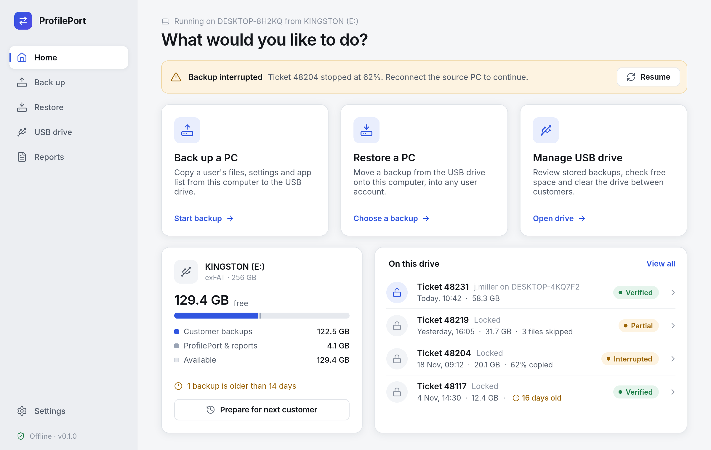

# ProfilePort

A portable Windows utility for moving a user's files and settings from one PC
to another via a USB drive. Plug in the drive, launch ProfilePort, pick a
user, and transfer their data — with verification and an honest report of
anything that couldn't be copied.

> **Status:** early prototype. The dashboard UI exists with sample data; the
> transfer engine has not been started.



## Stack

Rust + [Slint](https://slint.dev), shipped as a single portable executable for
Windows 10 and 11. See [ADR 0001](docs/decisions/0001-gui-framework.md) for
why Slint rather than Tauri.

## Repository layout

```text
apps/desktop/          Slint desktop app (prototype)
  ui/theme.slint       design tokens (colours, type, spacing, motion)
  ui/components.slint  reusable components
  ui/app.slint         main window / dashboard
  ui/icons/            Lucide icons (ISC)
  ui/fonts/            Inter (SIL OFL 1.1)
docs/decisions/        architecture decision records
docs/design/ui.md      visual system and UI workflow
docs/windows-gotchas.md platform behaviours the engine must handle
scripts/screenshot.sh  headless screenshots of the UI (Linux)
```

## Building

```sh
cargo run -p profileport-desktop          # run the prototype
PROFILEPORT_THEME=dark cargo run -p profileport-desktop
scripts/screenshot.sh                     # regenerate docs/screenshots (Linux + Xvfb)
```

For a Windows release build: `cargo build --release -p profileport-desktop`
on Windows (x64 or ARM64 native; see ADR 0005 on why not 32-bit).

## Key decisions

| Decision | Status |
|---|---|
| [Slint, not Tauri](docs/decisions/0001-gui-framework.md) | Accepted |
| [Encrypted, chunked package format](docs/decisions/0002-package-format.md) | Accepted |
| [Native Rust copy engine, not Robocopy](docs/decisions/0003-copy-engine.md) | Accepted |
| [Always run elevated](docs/decisions/0004-privilege-model.md) | Accepted |
| [Locked files: avoid, then VSS; registry archived, not merged](docs/decisions/0005-locked-files-and-registry.md) | Accepted |

## Suggested build order

1. **Engine as a CLI first:** profile discovery, export of known folders into
   the package format with manifest and hashes, restore to a different
   username, verification.
2. **Then the GUI on top**, once the engine survives pulled-USB tests.
3. **Then** installed-app inventory, browser adapters and USB management.
