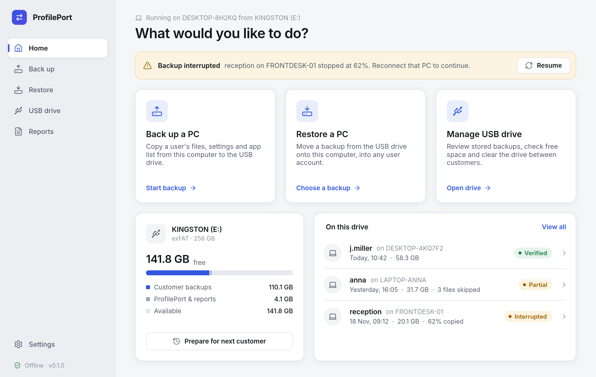
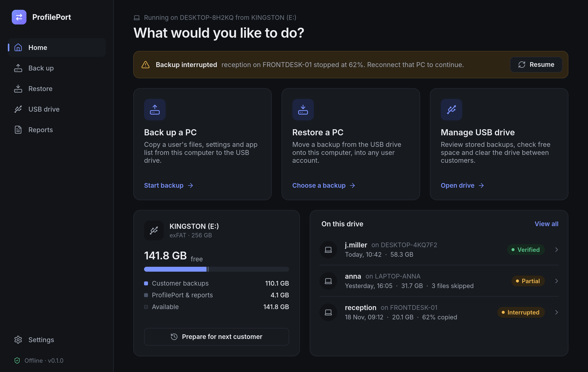

# UI design

The desktop UI is built in [Slint](https://slint.dev) (see
[ADR 0001](../decisions/0001-gui-framework.md)). This document describes the
visual system and how to work on it.

| Light | Dark |
|---|---|
|  |  |

## Principles

1. **One obvious next step.** Each screen has a clear primary action. The
   dashboard's three cards are the three jobs a technician comes to do.
2. **State is never hidden.** Interrupted, partial and verified backups look
   different at a glance (status badges), and problems surface as notices at
   the top of the page — never only in a log.
3. **Calm by default.** Neutral surfaces, one accent colour, colour reserved
   for meaning (green = verified, amber = needs attention, red = failure).
4. **Honest wording.** "Partial — 3 files skipped", not "Done". "Verified"
   only when content was hashed and compared.
5. **Dense enough for professionals.** Generous whitespace, but a technician
   should see drive state and recent backups without scrolling.

## Tokens

All colours, sizes and motion live in `apps/desktop/ui/theme.slint`
(`global Theme`). Components never use literal colours. Switching
`Theme.dark` re-themes the whole app.

| Group | Tokens |
|---|---|
| Neutrals | `window-bg`, `sidebar-bg`, `surface`, `surface-hover`, `surface-sunken`, `border`, `border-strong` |
| Text | `text-primary`, `text-secondary`, `text-tertiary` |
| Accent | `accent`, `accent-hover`, `accent-subtle`, `on-accent` |
| Status | `success`/`-subtle`, `warning`/`-subtle`/`-border`, `danger` |
| Type | `text-display` 28, `text-title` 17, `text-body` 14, `text-small` 13, `text-caption` 12 |
| Spacing | 4 px grid: `space-1` … `space-10` |
| Radius | `radius-small` 6, `radius-medium` 10, `radius-large` 14 |
| Motion | `motion-fast` 120 ms (hover), `motion-medium` 200 ms (movement) |

Dark mode uses its own lighter accent (`#7b93ff`) with dark text on accent
fills, rather than inverting the light palette, and drops shadows in favour of
borders.

## Typography

**Inter**, bundled in `ui/fonts/` (SIL OFL 1.1). Windows 11's Segoe UI
Variable isn't available on Windows 10, and plain Segoe UI renders noticeably
differently at the same sizes. Bundling Inter makes every machine look the
same and adds about 1 MB.

## Icons

[Lucide](https://lucide.dev) v0.460.0 (ISC licence), stored as SVGs in
`ui/icons/` with stroke width 1.75 and tinted at runtime via `colorize`. Add
new icons the same way. Do not mix icon families.

## Components (`ui/components.slint`)

`Icon`, `Label`, `Card`, `PrimaryButton`, `SecondaryButton`, `Badge`,
`NavItem`, `ActionCard`. Screen-level parts (`Sidebar`, `Notice`,
`DriveCard`, `BackupsCard`, `BackupRow`) are in `ui/app.slint` until a second
screen needs them.

Slint layout notes learned while building the prototype:

- Children of a layout can't set `x`/`y`. To centre a small fixed-size item
  in a row, place it inside a plain `Rectangle` (children of plain elements
  are centred by default). `Icon` does this internally.
- A fixed-width child in a `VerticalLayout` caps the layout's maximum width.
  In cards, put fixed-size tiles in a `HorizontalLayout` with a stretching
  spacer, or the card (and ultimately the window) stops growing.
- Equal-width columns: give each item the same `preferred-width` and
  `horizontal-stretch: 1`. Binding widths to the parent layout's width
  creates a binding loop.

## Screenshots

`scripts/screenshot.sh [scale]` builds the app and renders both themes under
Xvfb into `docs/screenshots/` (Linux; needs `xvfb`, `imagemagick`,
`xdotool`). Default scale is 2 for crisp images; use `1` for quick checks.
Sample data comes from `apps/desktop/src/main.rs`.

These are rendered with Slint's FemtoVG renderer on Linux. **Check on real
Windows hardware at 100 %, 125 % and 150 % scaling** before treating a design
as final. Font rasterisation and DPI behaviour differ there.

## Next screens

1. Profile discovery (pick a Windows installation and user).
2. Data selection with size estimates and exclusions.
3. Transfer progress (overall + current file, speed, ETA, warnings).
4. Verification summary (verified / partial / failed, with drill-down).
5. Restore mapping (source folders → destination user, conflict preview).
6. USB drive management and "Prepare for next customer".
